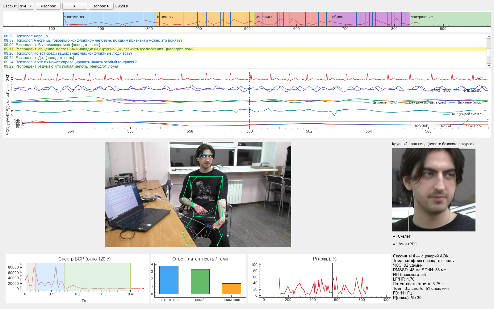

# Мультимодальное распознавание лжи

Для поиска признаков лжи проводится синхронный анализ видео интервью, речи и сигналов БиоРадио. Выборка состоит из 10 респондентов и 638 ответов, при этом каждый ответ имеет самоотчёт.



| Модуль | Методы |
|---|---|
| Синхронизация | синхронизация через дыхание (грудь и пояс), затем через пульс на лице и R-зубцы ЭКГ |
| Речь | WhisperX, определение ролей по голосу, структуре диалога и локальной LLM, латентность, паузы, темп, Praat, openSMILE |
| ЭКГ и ВСР | Индекс Баевского, NeuroKit2, окно скользящее по 120 с с шагом 5 с |
| Поза | RTMW, 133 точки |
| rPPG | GREEN, OMIT, CHROM, POS |
| Интерфейс | пять синхронизированных блоков |
| Анализ | нормировка для каждого человека, критерий Уилкоксона с FDR, смешанные модели, XGBoost с проверкой на новом человеке |

## Установка

Для работы требуются Python 3.12, ffmpeg и видеокарта NVIDIA с CUDA 12.8. Нужно подготовить токен Hugging Face в переменной `HF_TOKEN` или файле `../hf.token`. Также необходим локальный LLM-сервер, это по умолчанию LM Studio с моделью `gemma-4-26b-a4b-it`.

```bash
python -m venv .venv && .venv\Scripts\activate
pip install torch==2.8.0 torchaudio==2.8.0 torchvision==0.23.0 --index-url https://download.pytorch.org/whl/cu128
pip install -r requirements.txt && pip install -e .
```

Для запуска пайплайна без интерфейса используйте Docker:

```bash
docker build -t lie-detector .
docker run --gpus all -v "<путь>/Исходные данные:/Исходные данные" -v "$PWD/new:/app/new" -v "$PWD/data:/app/data" -e HF_TOKEN=... -e LLM_ENDPOINT=http://host.docker.internal:1234/v1 lie-detector
```

## Запуск

```bash
python scripts/run_pipeline.py
python scripts/analyze.py --stats-only
python -m lie_detector.gui s14
```

Запустите конкретный этап пайплайна с помощью флага `--only`. Чтобы продолжить работу с указанного шага, используйте флаг `--from`.

Для управления интерфейсом используется пробел, который ставит на паузу. Стрелки служат для пролистывания кадров. Клик по реплике или шкале осуществляет переход к выбранному моменту.

В папке `data/processed/labeling/` находятся листы для самоотчёта. Респондент заполняет свои строки символами Л или Ч, а пустая ячейка означает правду. Готовые листы хранятся в `data/processed/labeling-labeled/`.

## Результаты

| Показатель | Значение |
|---|---|
| Роли говорящих | Доля верных ролей на s10 составляет 95,6 % |
| ЭКГ и контактная ФПГ, s14 | ЧСС r составляет 0,999, ICC показателей ВСР от 0,96 до 0,99 |
| rPPG | В 10 из 10 сессий обнаружен пульс, медиана ошибки ЧСС составляет 7,2 уд/мин |
| Заранее заданные маркеры | При лжи растут латентность ответа и аномальность голоса, p 0,014 |
| XGBoost на новом человеке | AUC 0,63 при p 0,005, на одной речи 0,65 |
| Темперамент | 6 холериков, 3 флегматика, 1 меланхолик, значимых различий между холериками и флегматиками не обнаружено |

Методика находится в `docs/methodology.md`, таблицы расположены в `outputs/`, а графики можно найти в `notebooks/01_research_analysis.ipynb`.

## Ограничения

Используется одна камера без бокового ракурса. Контактная ФПГ есть только у s14. В выборке 10 человек, поэтому полученные эффекты носят предварительный характер.
